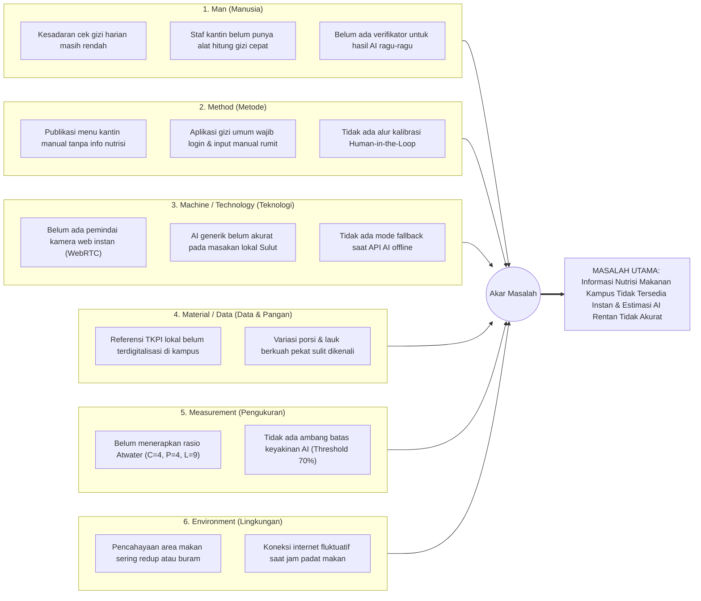

# Root Cause Analysis (RCA) & Fishbone Diagram
**Proyek:** AI-Powered Nutrition Analyzer System — Universitas Klabat (UNKLAB)  
**Fokus Masalah:** Ketidaktersediaan informasi gizi makanan kampus secara instan serta risiko ketidakakuratan estimasi nutrisi pada kuliner lokal.

---

## 1. Pernyataan Masalah (Problem Statement)

Di lingkungan **Universitas Klabat (UNKLAB), Airmadidi**, mahasiswa, dosen, dan warga kampus belum memiliki cara yang cepat, praktis, dan terpercaya untuk mengetahui estimasi total kalori (kkal) serta persentase makronutrien (**Karbohidrat, Protein, Lemak**, dan **Serat**) dari makanan harian yang dikonsumsi di kantin maupun *dining hall*. Di sisi lain, penggunaan AI pengenalan gambar secara mentah tanpa pengawasan manusia berisiko menghasilkan estimasi yang meleset pada masakan lokal Sulawesi Utara (seperti *Tinutuan*, *Cakalang Fufu*, *Ayam Woku*, *Ikan Kuah Asam*) atau saat kondisi foto kurang pencahayaan dan tertutup kuah pekat.

---

## 2. Fishbone Diagram (Diagram Ishikawa — 6M)

---

## 3. Root Cause Analysis (Metode 5 Whys)

### A. Mengapa sivitas akademika tidak mengetahui kandungan gizi makanan harian di kampus?
1. **Why 1:** Mengapa mahasiswa dan dosen jarang mengecek kalori & makronutrien makanannya?  
   $\rightarrow$ Karena menu harian di kantin/dining hall tidak menampilkan rincian kalori dan persentase gizi.
2. **Why 2:** Mengapa petugas kantin tidak mencantumkan nilai gizi pada papan menu harian?  
   $\rightarrow$ Karena menghitung kalori tiap bahan secara manual memakan waktu dan rentan salah hitung.
3. **Why 3:** Mengapa tidak menggunakan aplikasi pelacak kalori yang sudah ada di pasaran?  
   $\rightarrow$ Karena aplikasi umum mewajibkan registrasi akun (*high friction*), mengetik bahan satu per satu, dan jarang memiliki data masakan lokal Minahasa/Sulawesi Utara.
4. **Why 4:** Mengapa belum tersedia sistem internal kampus yang praktis?  
   $\rightarrow$ Karena belum ada platform web *mobile-first* tanpa login yang menggabungkan pemindai kamera AI dengan papan menu harian *dining hall*.
5. **Why 5 (Root Cause A):**  
   **Tidak adanya platform *Zero-Friction* berbasis kamera web (WebRTC) yang terintegrasi dengan data menu harian kantin UNKLAB dan kalkulator gizi otomatis berbasis TKPI.**

---

### B. Mengapa hasil deteksi nutrisi berbasis AI sering meleset pada makanan lokal kampus?
1. **Why 1:** Mengapa estimasi kalori dari kamera AI terkadang tidak akurat?  
   $\rightarrow$ Karena AI kesulitan membedakan isi lauk yang tertutup kuah pekat, foto buram, atau pencahayaan redup.
2. **Why 2:** Mengapa hasil yang meragukan tersebut tetap bisa menyesatkan pengguna?  
   $\rightarrow$ Karena sistem AI konvensional langsung menampilkan hasil seolah-olah 100% benar tanpa indikator tingkat keyakinan (*confidence score*).
3. **Why 3:** Mengapa tidak ada mekanisme penyaringan terhadap hasil AI yang kurang yakin?  
   $\rightarrow$ Karena tidak ditetapkan ambang batas (*confidence threshold*) untuk memisahkan hasil valid dan hasil ambigu.
4. **Why 4:** Mengapa hasil ambigu tidak diperbaiki oleh pengelola?  
   $\rightarrow$ Karena tidak tersedia antrean tinjauan (*review queue*) dan alat kalibrasi manual bagi Administrator.
5. **Why 5 (Root Cause B):**  
   **Belum diterapkannya mekanisme *Human-in-the-Loop* (HITL) dengan ambang batas *confidence score* 70% serta *Local Heuristic Fallback* untuk menjamin integritas data gizi di lapangan.**

---

## 4. Pemetaan Akar Masalah ke Solusi Sistem

| Kategori Fishbone | Akar Masalah Teridentifikasi | Solusi yang Diimplementasikan pada Sistem |
| :--- | :--- | :--- |
| **Man** | Pengguna enggan proses rumit; belum ada verifikator | Akses publik **Tanpa Login** + pemisahan peran **RBAC** (Public, Petugas, Admin). |
| **Method** | Input menu manual tanpa gizi; tidak ada validasi | **Manual Menu Builder** + **Alur Eskalasi HITL** (`auto_approved` vs `pending_admin_review` $\rightarrow$ `admin_corrected`). |
| **Machine** | Tidak ada kamera instan; risiko API offline | **WebRTC Camera Scanner** (`getUserMedia`), **Gemini 2.5 Flash**, dan **Local Heuristic Fallback** (< 70%). |
| **Material** | Kuliner lokal Sulut tidak ada di database generik | **Master Data Pangan TKPI** berisi masakan Indonesia & khas Sulut (*Tinutuan, Cakalang Fufu, Ayam Woku, Kuah Asam*). |
| **Measurement** | Perhitungan makro tidak konsisten; tanpa ambang batas | **Faktor Atwater** ($1\text{g } C=4$, $1\text{g } P=4$, $1\text{g } L=9\text{ kkal}$, total tepat 100%) + **Threshold 70%**. |
| **Environment** | Foto gelap/kuah pekat & jaringan tidak stabil | Deteksi otomatis *confidence* < 70% dengan pencatatan `ai_uncertainty_reason` & mode fallback lokal. |
